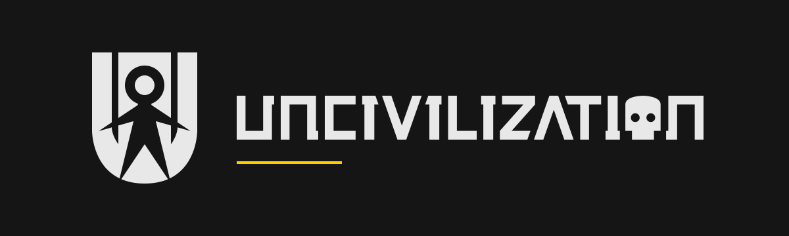

[](https://uncvl.xyz)

# uncvl.xyz

This is the home of **[uncvl.xyz](https://uncvl.xyz)**, the website of **Uncivilization**. Everything on the site lives here: our events, our label releases, artist pages and news.

You don't need to know anything about code to add to it. There is a simple editor in the browser, and this page explains the rest.

> **Türkçe:** Bu depo, Uncivilization'ın sitesi [uncvl.xyz](https://uncvl.xyz)'nin evidir. Etkinlik, yayın, sanatçı ya da haber eklemek için kod bilmene gerek yok: **[uncvl.xyz/admin](https://uncvl.xyz/admin/)** adresinden GitHub hesabınla giriş yap, formu doldur, kaydet. Adım adım anlatım için: [docs/EDITING.md](docs/EDITING.md) (Türkçe bölüm aşağıda).

---

## What's on the website

| Page | What you'll find there |
|---|---|
| **Home** | Who we are, upcoming events, latest releases and news |
| **[Events](https://uncvl.xyz/events/)** | Every Uncivilization night, past and upcoming, grouped as Art, Break, Bass, Punk and Synth. Each event has its poster, lineup, times, venue, tickets and photos |
| **[Releases](https://uncvl.xyz/releases/)** | Our label's records, with players for Bandcamp and SoundCloud |
| **Artists** | One page per artist: bio, links, and every event and release they were part of. All of them, A to Z, at [uncvl.xyz/artists](https://uncvl.xyz/artists/) (not in the menu) |
| **[Posts](https://uncvl.xyz/posts/)** | News and announcements, like open calls |
| **[About](https://uncvl.xyz/about/)** | The Uncivilization story |
| **[Organization](https://uncvl.xyz/organization/)** | How we work together, and the work units you can join |
| **[Concept](https://uncvl.xyz/concept/)** | The ideas behind it all: existence and extinction, the [World Building Project](https://uncvl.xyz/concept/world-building/), the [Sound](https://uncvl.xyz/sound/) and, later, the themes |

There's also a **[Chat](https://uncvl.xyz/chat/)** that isn't in the menus: share the link. It needs no account and keeps no history; messages go straight between the browsers of the people in the room at that moment. Add a room name and a password for a private room. The **share** button at the top shares the room link (on phones) or copies it; the password is never in the link. Type `/nick newname` to change your name (everyone in the room sees the change). You can also post a poll (the **/** button → /poll, or type `/poll question | option | option`); everyone in the room can vote, and change or take back their vote.

Every page is in **English and Turkish**. Visitors switch with the **EN | TR** button at the top, and the site remembers their choice.

---

## How to add or change something

1. Go to **[uncvl.xyz/admin](https://uncvl.xyz/admin/)**.
2. Click **Sign in with GitHub** and log in with your GitHub account.
3. Pick what you want to work on: **Events**, **Releases**, **Artists**, **Posts** or **Settings**.
4. Click **New** (or open an existing one), fill in the form and upload the poster or photos.
5. Click **Save**. This keeps your work as a **draft**. Nothing is public yet.
6. When it's ready, set it to **Ready** and then **Publish**.

About a minute or two later, your change is live on uncvl.xyz.

A more detailed guide, in both English and Turkish, is in **[docs/EDITING.md](docs/EDITING.md)**.

### Good to know

- **No access?** You need a free [GitHub](https://github.com) account, and someone from the crew has to add you to the [uncvl](https://github.com/uncvl) organization with write access to this repository. Ask in the group.
- **Write both languages if you can.** Each form has an English and a Turkish box. If one is empty, the page shows the other language instead.
- **Upload the biggest version** of a poster or photo. The site makes the smaller versions for phones itself.
- **Upcoming and past sort themselves.** Once an event's date has passed, it moves to the past events on its own. You don't have to do anything.
- **Codename** is the computer-science name of a night, like *zero day exploit* or *break protocol*. It shows as the big glitchy title on the event page.
- **Mistakes are safe.** Every change is saved with its history, so anything can be undone. If something goes wrong while the site is being updated, the old version simply stays online.

### Need help?

Ask in the crew group, or write to [info@uncvl.xyz](mailto:info@uncvl.xyz).

---

<details>
<summary><strong>Technical details (for maintainers)</strong></summary>

### Overview

- Static site built with [Eleventy](https://www.11ty.dev/) 3. Content is Markdown with front matter.
- Edited with [Sveltia CMS](https://sveltiacms.app/) at `/admin/`. Login is GitHub OAuth, with the code-for-token step done by the site's own Worker (`/api/auth`). It uses the editorial workflow (drafts are pull requests).
- Hosted on GitHub at [uncvl/uncvl.xyz](https://github.com/uncvl/uncvl.xyz). Cloudflare Workers Builds builds every push to `main` and deploys it to a Cloudflare Worker with static assets (`wrangler.jsonc`, Worker `uncvl`).
- Media lives on Cloudflare R2 (`uncvl-media`, public at `https://media.uncvl.xyz`). Originals and private material are in `uncvl-archive` (private).
- Open questions from the content migration: [docs/CONTENT-NOTES.md](docs/CONTENT-NOTES.md).

### Develop

Requires Node 20 or newer.

```sh
npm ci
npm run serve            # http://localhost:8080
npm run build            # → _site/
npm run check            # broken links, missing alt text, CSP-unsafe markup
npm run strip-metadata   # remove EXIF/XMP/GPS from images in src/ (lossless); run before committing new photos
```

### Layout

| Path | What |
|---|---|
| `src/events/<yyyy-mm-dd-name>/index.md` | one event: front matter, with any local images next to it |
| `src/releases/<yyyy-mm-dd-name>/index.md` | one release (label discography) |
| `src/artists/<slug>.md` | artist bios, linked from events and releases; `src/artists.njk` lists them all at /artists/ (not linked from the menu) |
| `src/posts/` | news and announcements |
| `src/work-units/` | work units → cards on /organization/ |
| `src/pages/` | about, organization, concept and world building pages (fixed settings like the URL are in the `.11tydata.js` files next to them) |
| `src/calls/` | open calls (e.g. the compilation call), shown in the CALLS box on the home page |
| `src/sound/genres/`, `src/sound/supergenres/` | music genres and supergenres → /sound/ pages; events, artists and releases link to them by name |
| `src/_data/site.json`, `home.json`, `vocab.json`, `sound.json` | socials, e-mails, navigation, home page texts; lists for activities and act types; Sound page texts |
| `src/_data/media.json` | manifest of images on R2 (width, height, content version) |
| `src/_includes/` | layouts, macros |
| `src/assets/` | CSS, JS (language switch, click-to-load players), self-hosted fonts |
| `brand/` | vector logo masters. `scripts/brand.mjs` builds the inline SVGs, favicons, social card and this README's banner (`docs/logo-banner.svg`) from them |
| `public/` | copied as-is: `_headers` (CSP, HSTS), `_redirects` (old `.html` URLs), `admin/` (CMS) |
| `worker/index.js` | the only server code: the `/api/media` upload endpoint for the CMS |
| `templates/` | copy-paste starters for events and releases |

### How it works

- **Images:** served from R2 and resized by Cloudflare Image Transformations (`/cdn-cgi/image/…`, 400/800/1400 px, AVIF/WebP per browser). Images not in `media.json` fall back to the local `@11ty/eleventy-img` pipeline.
- **Languages:** EN and TR live in the same file (`text_en` / `text_tr`). A small script shows one at a time and remembers the choice. Without JavaScript both are shown.
- **Upcoming/past:** computed from `date` at build time. CI rebuilds daily (cron `17 3 * * *`).
- **Privacy/security:** no third-party requests on page load. Fonts are self-hosted, and YouTube, Bandcamp and SoundCloud players load only after a click. A strict CSP is in `public/_headers`. `/admin/*` has its own CSP.
- **Glitch scroll:** while you scroll fast, letters lag behind and catch up (the middle of each line last). `src/assets/js/scroll-fx.js` lays out the text with [Pretext](https://github.com/chenglou/pretext) and redraws it on one canvas; the real text is hidden only while letters move. It's off by default; the warning-sign button next to EN | TR turns it on (remembered per browser).

- **Chat (`/chat/`):** `src/chat.njk` + `src/assets/js/chat.js`, built on [Trystero](https://github.com/dmotz/trystero) (MIT). `scripts/vendor.mjs` bundles it with esbuild into `.vendor/` (git-ignored) on every build. Browsers find each other through a few public Nostr relays (`RELAYS` in chat.js; the same list is allowed in the `/chat/*` CSP in `public/_headers`), then talk directly over WebRTC. The handshake is encrypted, with the room password if one is set. STUN only (no Google or Cloudflare servers), no TURN relay, so people behind networks that block direct connections can't join. Polls stay as long as anyone in the room has them: everyone keeps a copy of the polls and votes they have seen in their own signed Trystero user state and passes it on (newest vote per person wins; while a voter is present only their own state counts for them). The people list brackets those whose connections come from the same address (compared via WebRTC stats, never shown). Nothing is stored; the page is `noindex` and not in the sitemap.

### CMS uploads to R2

Uploads from the CMS go straight to R2 under `uploads/` through the site's own endpoint `/api/media` (`worker/index.js`, a minimal S3 API). There are no keys to share:

- `public/admin/media-session.js` hands the editor's GitHub token to `/api/media/session`.
- The Worker stores the token in an HttpOnly cookie and accepts it only if that GitHub account can push to this repo (checked against the GitHub API, cached 5 minutes).
- Only `/api/*` runs Worker code. Everything else is served as static assets.

### Maintainer uploads

Put the maintainer R2 key in your environment. Never commit keys.

```sh
# PowerShell: $env:R2_ACCOUNT_ID="…"; $env:R2_ACCESS_KEY_ID="…"; $env:R2_SECRET_ACCESS_KEY="…"
npm run r2:media -- --dry-run          # preview
npm run r2:media                       # upload src images → uncvl-media, update media.json
npm run r2:media -- --prune            # …and delete local copies that are verified on R2
npm run r2:file -- <file.mp4> events/<bundle>/<file.mp4>   # single file (e.g. promo video)
npm run r2:archive -- ../reference_sources reference_sources   # originals → uncvl-archive (private)
```

Then commit `src/_data/media.json` (and the removed local files).

### Deploy

Cloudflare Workers Builds is connected to this repository (Cloudflare dashboard → Workers & Pages → `uncvl` → Settings → Build). No deploy keys live on GitHub. Settings there:

- Production branch `main`. Build command `npm run build && npm run check`. Deploy command `npx wrangler deploy`.
- Dependencies are installed from `package-lock.json`. Node is Cloudflare's default (24; `package.json` needs 20 or newer).
- Build logs stay in the Cloudflare dashboard; each build also shows up as a check on the GitHub commit.

Upcoming vs past events is decided at build time. `.github/workflows/rebuild-after-event.yml` pushes an empty commit at 00:17 Istanbul time on the day after an event, so Cloudflare rebuilds and the event moves to "past". Run it by hand from the Actions tab to force a rebuild.

CMS sign-in (`/api/auth` in `worker/index.js`) needs a GitHub OAuth app in the uncvl organization, with the callback URL `https://uncvl.xyz/api/auth/callback`. Its Client ID is `GITHUB_CLIENT_ID` in `wrangler.jsonc`. Its client secret is a Worker secret: `npx wrangler secret put GITHUB_CLIENT_SECRET`.

Local test of the Worker: `npm run build && npx wrangler dev --local`. To point the login check at a mock, put `GITHUB_API=…` in `.dev.vars`.

</details>
